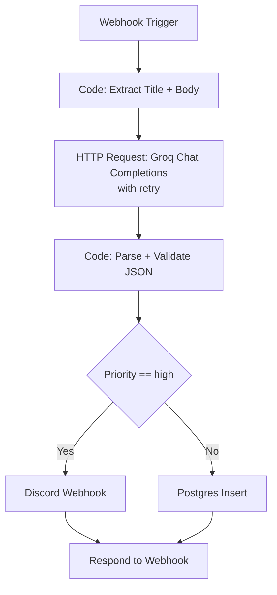

# n8n Issue Triage Automation

An n8n workflow that receives GitHub issue text via webhook, classifies it with an LLM (Groq / Llama 3), and routes high-priority to Discord while logging everything else to Postgres.

> **Status:** in progress. Workflow nodes are being built incrementally;
> sections marked TODO are pending.

## Problem

Manual issue triage is slow and inconsistent. High-priority bugs get buried under lower-value questions and feature requests. The goal is to classify every incoming issues the moment it arrives, route urgent ones to a channel where they'll be seen, and keep a searchable log of everything for later analysis.

## Architecture

The workflow follows the trigger → steps → data flow → decisions → failure paths model:




<details>
<summary>Plain-text version</summary>
	Webhook Trigger
		│
		▼
	Code: extract title + body
	      	│
		▼
	HTTP Request: Groq chat completions ← LLM classification (with retry)
	     	│
                ▼
	Code: parse + validate JSON ← deterministic schema enforcement
	      	│
                ▼
	IF: priority == "high" ? ← decision point
	├── True → Discord webhook ← notification ─┐
	└── False → Postgres insert ← logging	  ─┤
						   ▼
						Respond to Webhook: JSON summary ← clean output to caller
```
</details>

### Triggers
- **Webhook (POST)** - entry point. Receives `{title, body, url}`.

### Steps
- **Code: extract** - normalizes payload, builds the prompt string.
- **HTTP Request: Groq** - calls `/chat/completions` with a system prompt that demands strict JSON. Configured with retry-on-fail.
- **Code: parse** - extracts `choices[0].message.content`, strips markdown fences, `JSON.parse`s, falls back to a safe default on failure.

### Data Flow
Webhook JSON → normalized `{issueTitle, issueBody, promptText}` → Groq API envelope → `{category, priority, suggestedAction, originalTitle, originalURL }` → routed as a single item through the rest of the pipeline.

### Decisions
- **IF priority == high** - high-priority issues go to Discord for immediate attention; everything else is logged silently.

### Failure paths
- **Groq call fails** - HTTP Request node retries 3x with 2s backoff.
- **Groq returns non-JSON** - Code node catches `JSON.parse` errors and emits a safe `{category: "unknown", priority: "medium"}` item with the raw response attached for debugging.
- **Webhook payload issing fields** - TODO: add validation and a 400 response.
- **Discord unreachable** - TODO: decide whether to retry or log-and-contine.

## Node Breakdown
| Node | Type | Purpose | Why this node |
|------|------|---------|---------------|
| Webhook | Trigger | Receives POST with issue text | Push-based entry point; lower latency than polling|
| Extract Issue Text | Code | Normalize payload into prompt string | Isolates input shape from downstream node |
| Call Groq | HTTP Request | LLM classification | Full control over request body and response format |
| Parse Groq Response | Code | Extract JSON from API envelope | Deterministic schema enforcement; handles malformed output |
| Priority Check | IF | Route on `priority == "high"` | Simple string comparison - no LLM needed |
| Discord | Discord | Notify on high priority | Native node handles auth and formatting |
| Log to Postgres | Postgres | Persist classification | Structured, queryable log |
| Respond to Webhook | Respond | Return JSON summary | Clean contract for the caller |

## Design Decisions

### Why n8n instead of custom Python

The value of this project is in **orchestration**, not computation. There's a webhook, an API call, a parse step, a conditional, and two sinks. In n8n that's 8 nodes and 15 minutes of wiring. In Python it's a FastAPI service, a retry decorator, a Postgres client, a Discord client, and a test suite - more code, more surface area, no more capability.

n8n is the right tool when the work is integration-heavy and the logic between integrations is mostly routing and transformation. It's the wrong tool when you need fine-grained performance control, complex algorithmic logic, or libraries n8n's Code node restricts.

**The hybrid answer**: use n8n for orchestration, entry points, and integrations. Offload heavy processing - RAG chunking, large-file handling, complex agent loops - to Python microservices. Both run on the same infrastructure.

### Why a minimal two-container stack (n8n + Postgres)

The official n8n Docker Compose guide ships a much larger stack: `sandbox-certs`, `sandbox-api`, `sandbox-runner-1` (privileged Docker-in-Docker), `runners`, and `searxng`. That stack exists to power n8n Assistant and agentic features that execute AI-generated code in isolation.

This workflow calls the Groq API directly via HTTP Request nodes. It does not let n8n Assistant write and execute code. So the sandbox services add resource usage - including a privileged container and mTLS setup - without adding capability for this use case. On a constrained dev machine, the minimal stack is the deliberate choice.

For a workflow that needed agentic AI with code execution, I would add the sandbox services or configure Daytona (the production sandbox provier n8n recommends).

### Why Postgres for logging

Three reasons over Google Sheets or a file:
1. I already run Postgres for n8n's own state, so there's no new service.
2. Structured queries - I can ask "how many high-priority bugs last week" without leaving SQL.
3. It's what the production version of this workflow would use, so the design doesn't have to change when it graduates from prototype.

### Why the HTTP Request node for Groq

n8n has LangChain-based AI nodes, but the HTTP Request node gives full control over the request body. Groq's `/chat/completions` endpoint is OpenAI-compatible, so the request is a straightforward POST. It also demonstrates understanding of the API contract rather than a pre-build abstraction - useful for a portfolio.

Note: n8n's built-in Structured Output Parser has a known incompatibility with Groq (Groq wraps responses in a hidden tool call that the parser can't unpack, causing a 400). Parsing the JSON manually in a Code node avoids this and gives control over cleaning markdown fences.

### Deterministic Logic Vs. AI

The LLM does the fuzzy work: classifying free-text into a small set of categories and priorities. Deterministic code does everything else: building the prompt, parsing the response, validating the schema, routing on the result. This split matters because LLM output is probabilistic and code is testable. If the classifier is wrong, I can adjust the prompt. If the parser is wrong, I can write a unit test.

## Setup

### Prerequisites
- Docker Engine and Docker Compose v2
- A Groq API API key
- A Discord webhook URL

### Run it

```bash
git clone https://github.com/aetheric0/n8n-triage.git
cd n8n-triage
cp .env.example .env
# edit .env with your POSTGRES_PASSWORD
docker compose up -d

Open `http://localhost:5678`, create an owner account, and import the workflow from `workflows/issue-triage.json`.

### Test it
```
curl -X POST http://localhost:5678/webhook/github-triage \
     -H "Content-Type: application/json" \
     -d '{"title": "App crashes on login", "body":"Steps: 1. Open 2. Enter creds 3. Freeze"}'
```

### Limitations and What I'd Change
- **No authentication on the webhook.** Anyone who knows the URL can post to it. In production I'd add a shared secret header check or put it behind an API gateway.
- **Single provider for the LLM.** If Groq is down, classification stops. I'd add a fallback provider (OpenAI, Anthropic) behind the same prompt.
- **No tests for the Code nodes.** n8n doesn't have first-class unit testing. I'd extract the parsing logic into a standalone module and test it with a JS test runner.
- **Workflow JSON doesn't diff well in Git.** Every save produces a large noisy JSON file. For a team, I'd export the workflow as code and keep the canonical version outside n8n.

---

